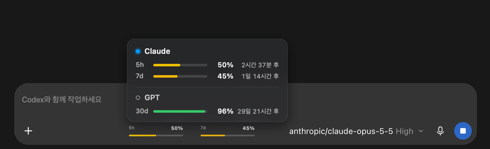

<p align="center">
  
</p>

<h1 align="center">Tidemark</h1>

<p align="center">
  남은 Codex 사용량을 입력창 안에서 바로 보여줍니다.<br>
  <a href="README.md">English</a>
</p>

---

Tidemark는 Codex 데스크톱 앱 입력창의 빈 공간에 **5h**와 **7d** 막대 두 개를 띄웁니다. 지금 선택한 모델 기준으로 사용 한도가 얼마나 남았는지 보여줍니다. 막대에 마우스를 올리면 모서리에서 카드가 튀어나와, 모든 제공자의 남은 사용량과 각 한도가 언제 초기화되는지 한 번에 보여줍니다.

OpenCodex로 Claude 같은 다른 제공자를 Codex에 연결해 쓴다면, Tidemark가 모델 선택기를 따라갑니다. `anthropic/claude-…`를 고르면 Claude 한도가, GPT 모델을 고르면 다시 GPT 한도가 표시됩니다.

## 기능

- **모델 선택기를 따라갑니다.** 입력창에서 선택된 모델을 읽어, 바꾼 뒤 0.1초 안팎에 해당 한도로 바꿔 보여줍니다.
- **호버 카드.** 모든 제공자의 남은 비율과 초기화까지 남은 시간을 함께 보여줍니다. 지금 쓰는 제공자는 왼쪽 점이 채워져 있습니다. 배경 블러, 물방울 애니메이션, 라이트·다크 모드를 지원합니다.
- **작업을 방해하지 않습니다.** 클릭은 그대로 아래로 통과하고, Dock 아이콘도 메뉴 막대 아이콘도 창도 없습니다.
- **가볍습니다.** 프로세스 하나로 동작하며, Codex가 앞에 있을 때 메모리 약 11MB, CPU는 코어 하나의 1% 미만을 씁니다. 그 밖에는 거의 쓰지 않습니다. Codex가 꺼져 있으면 Codex가 켜지기를 기다리기만 합니다.
- **두 가지 언어.** 영어판과 한국어판을 따로 빌드해 각각 최대한 작게 유지합니다.

## 요구 사항

| | |
|---|---|
| macOS | Apple 실리콘은 macOS 12 Monterey 이상, Intel은 macOS 14 Sonoma 이상 |
| Codex | 로그인된 Codex / ChatGPT 데스크톱 앱 (번들 ID `com.openai.codex`) |
| 선택 | Claude 등 다른 제공자 한도를 보려면 OpenCodex |

## 설치

1. [Releases](../../releases)에서 `Tidemark-<버전>-ko.zip`을 내려받습니다. 영어판은 `-en.zip`입니다.
2. 압축을 풀고 **Tidemark.app**을 **응용 프로그램** 폴더로 옮깁니다.
3. 앱을 엽니다. 공증(notarization)을 받지 않은 앱이라 처음 실행할 때 macOS가 막습니다. **시스템 설정 → 개인정보 보호 및 보안**에서 **그래도 열기**를 누르거나, 터미널에서 다음을 실행합니다.
   ```sh
   xattr -dr com.apple.quarantine /Applications/Tidemark.app
   ```
4. **손쉬운 사용** 권한을 요청하면 허용합니다(**시스템 설정 → 개인정보 보호 및 보안 → 손쉬운 사용**). 입력창 위치를 찾고 모델 선택기 글자를 읽는 데 필요합니다.

처음 실행하면 로그인 항목에 스스로 등록됩니다(macOS 13 이상). 원하지 않으면 **시스템 설정 → 일반 → 로그인 항목**에서 끌 수 있습니다.

> 별도 개발자 인증서 없이 서명한 앱이라, 새 버전으로 업데이트하면 손쉬운 사용 권한을 다시 물을 수 있습니다. 기존 항목을 지우고 새로 허용해 주세요.

## 숫자는 어디서 오나요

| 한도 | 출처 |
|---|---|
| GPT 모델 | Codex가 직접 쓰는 `https://chatgpt.com/backend-api/wham/usage`. 접근 토큰은 `~/.codex/auth.json`에서 메모리로만 읽고 chatgpt.com에만 보냅니다. OpenCodex가 실행 중이면 호버 카드에는 활성 ChatGPT 계정에 대해 OpenCodex가 캐시한 값을 씁니다. |
| Claude 등 다른 제공자 | OpenCodex가 갱신하는 `~/.opencodex/provider-account-quota-cache.json`. 읽기만 합니다. |
| 선택된 모델 | 손쉬운 사용 API로 읽은 입력창의 모델 선택기 |

Tidemark는 Codex나 OpenCodex 파일에 아무것도 쓰지 않고, 다른 곳으로 아무것도 보내지 않습니다. Tidemark 자체 파일은 `~/Library/Application Support/Tidemark`에 있습니다.

## 설정

필요할 때만 쓰면 됩니다. `~/Library/Application Support/Tidemark/config.json` 파일에 아래 키 중 원하는 것만 넣고 Tidemark를 다시 실행하세요.

| 키 | 기본값 | 의미 |
|---|---|---|
| `VisualScale` | `0.95` | 막대 크기 |
| `HorizontalOffset` | `0` | 좌우 위치 미세 조정(포인트) |
| `BottomOffset` | `32` | 입력창 아래쪽 버튼 줄을 못 찾았을 때의 세로 위치 |
| `TrackingIntervalMs` | `8` | 창을 움직이거나 크기를 바꿀 때 따라가는 주기 |
| `UsageRefreshIntervalMs` | `60000` | GPT 사용량을 가져오는 주기 |

```json
{ "VisualScale": 1.0, "HorizontalOffset": -4 }
```

## 소스에서 빌드

Xcode 또는 Command Line Tools(Swift 5.9 이상)가 필요합니다.

```sh
git clone https://github.com/Qualop/tidemark.git
cd tidemark
Scripts/install.sh ko     # 한국어판, ~/Applications에 설치
Scripts/install.sh        # 영어판
```

`Scripts/build-release.sh`는 유니버설 릴리즈 압축 파일을 `dist/`에 만듭니다. `swift run TidemarkChecks`로 사용량 파싱 검증을 실행할 수 있습니다.

## 삭제

```sh
Scripts/uninstall.sh
```

직접 지우려면 Tidemark를 종료하고(`pkill -x Tidemark`) 앱과 `~/Library/Application Support/Tidemark` 폴더를 삭제하면 됩니다.

## 가볍게 유지하는 방법

- 입력창은 손쉬운 사용 트리를 한 번 훑어 찾고, 찾는 즉시 탐색을 멈춥니다. 그 뒤로는 요소마다 필요한 속성 몇 개만 요청 한 번에 묶어 읽습니다.
- 위치는 0.1초마다 확인하고, 창을 움직이거나 입력창 크기가 바뀔 때만 빠르게 따라갑니다.
- 마우스 움직임은 Codex가 맨 앞에 있을 때만 봅니다. 호버 카드는 처음 쓸 때 만들어지고, 비트맵 한 장과 Core Animation 레이어 몇 개로 그려지며, 사라지면 메모리를 돌려줍니다.

## 라이선스

[MIT](LICENSE). Tidemark는 OpenAI 및 Anthropic과 관련이 없습니다.
