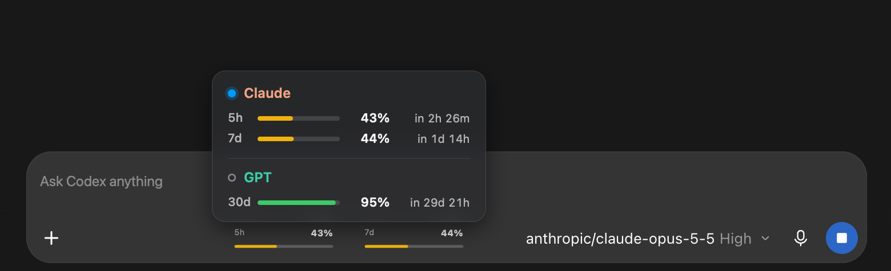

<p align="center">
  
</p>

<h1 align="center">Tidemark</h1>

<p align="center">
  Your remaining Codex and Claude quota, right in the composer.<br>
  <a href="README.ko.md">한국어</a>
</p>

---

Tidemark puts two small bars, **5h** and **7d**, in the empty space of the composer in the Codex and Claude desktop apps. In Codex they show how much of your rate limit is left for the model you have selected; in Claude they show your Claude limits on one compact line under the prompt box. Hover over them and a card pours out of the bars with the macOS Genie effect, showing every provider's quota and when each window resets.

If you route Claude or other providers into Codex through OpenCodex, Tidemark follows the model picker. Choose `anthropic/claude-…` and the bars switch to your Claude limits; choose a GPT model and they switch back.

## Features

- **Follows the model picker.** Reads the selected model from the composer and shows the matching quota within about 0.1 s of a change.
- **Knows your plan.** On plans where the 5-hour limit never binds (Claude Ultra, ChatGPT Pro), the 5h bar is replaced by the plan name, so you see `Ultra | 7d ━━ 100%`. Plans with only a monthly window show `30d`.
- **Codex and Claude.** Works in both desktop apps and follows whichever one is in front. Claude's control row is thin, so there the bars switch to a one-line layout.
- **Hover card.** All providers at once, with reset countdowns. The provider you are using is shown in its colour with a filled dot; the others are grey. Blurred background, the macOS Genie effect in and out, light and dark mode.
- **Token speed per model.** The hover card also lists each app's recent reply speed (tok/s) per model, measured separately for Codex and the Claude app from their own session logs.
- **Stays out of the way.** Clicks pass straight through. No Dock icon, no menu bar icon, no windows.
- **Light.** One process using about 11 MB of memory and under 1% of one CPU core while Codex is in front, and close to nothing otherwise. While Codex is closed, Tidemark only waits for it to launch.
- **Two languages.** English and Korean are separate builds, so each stays as small as possible.

## Requirements

| | |
|---|---|
| macOS | 14 Sonoma or later (Apple silicon and Intel) |
| Apps | The Codex / ChatGPT desktop app (`com.openai.codex`) and/or the Claude desktop app (`com.anthropic.claudefordesktop`) |
| Optional | Claude Code, OpenCodex or Gemini CLI signed in, for more providers (see below) |

## Install

1. Download `Tidemark-<version>-en.zip` (or `-ko.zip` for Korean) from [Releases](../../releases).
2. Unzip it and move **Tidemark.app** to **Applications**.
3. Open it. Tidemark is not notarized, so macOS blocks the first launch. Go to **System Settings → Privacy & Security** and click **Open Anyway**, or run:
   ```sh
   xattr -dr com.apple.quarantine /Applications/Tidemark.app
   ```
4. Allow **Accessibility** access when asked (**System Settings → Privacy & Security → Accessibility**). Tidemark uses it to find the composer and read the model picker. Once access is granted, it asks both Codex and Claude to expose their Electron accessibility trees.

Tidemark adds itself to Login Items when it starts, and checks again on every launch in case macOS dropped the registration. If you turn it off in **System Settings → General → Login Items**, it stays off.

> The app is ad-hoc signed, so after an update macOS may ask for Accessibility permission again. Remove the old entry and allow the new one.

## Where the numbers come from

No extra service is required. Each provider is read straight from the tool you already use, best source first:

| Quota | Source |
|---|---|
| GPT | `chatgpt.com/backend-api/wham/usage`, the endpoint Codex itself uses, with the Codex login in `~/.codex/auth.json`. OpenCodex's cache is only a fallback. |
| Claude | 1. Claude Code's login, **only if you opt in** with `ClaudeKeychain` (exact 5h and 7d limits from `api.anthropic.com/api/oauth/usage`). 2. OpenCodex's quota cache, if installed. 3. The Claude app's own usage indicator (5h only, read while Claude is in front). |
| Gemini | Gemini CLI's login in `~/.gemini/oauth_creds.json` (daily Pro and Flash limits). Shown only when Gemini CLI is signed in to an account with Code Assist quota. An expired token is refreshed in memory; nothing is written back. |
| Selected model | The composer's model picker, read through the Accessibility API. |
| Token speed | The apps' own local logs, `~/.codex/sessions` (Codex Desktop sessions) and `~/.claude/projects` (Claude desktop app entries): only timestamps, output-token counts and model names are read, and only the newly appended part of a log. Output tokens ÷ time from request to the end of the reply, so it includes time to first token. Claude's chat mode keeps no local log and is not measured. |

Tokens are read only when needed, kept in memory, and sent only to their own vendor. Each request runs at most once a minute (Gemini every five minutes).

Tidemark never writes to Codex or OpenCodex files and sends nothing anywhere else. Its own files live in `~/Library/Application Support/Tidemark`.

## Configuration

Optional. Create `~/Library/Application Support/Tidemark/config.json` with any of these keys, then restart Tidemark.

| Key | Default | Meaning |
|---|---|---|
| `VisualScale` | `0.95` | Size of the bars |
| `HorizontalOffset` | `0` | Nudge left or right, in points |
| `BottomOffset` | `32` | Vertical position when the footer row can't be found |
| `TrackingIntervalMs` | `8` | Follow rate while the window moves or resizes |
| `UsageRefreshIntervalMs` | `60000` | How often usage is fetched |
| `ClaudeKeychain` | `false` | Read Claude Code's login from the Keychain for exact Claude limits. macOS asks for permission once (and again after an update, since the app is ad-hoc signed). |
| `NoFiveHourPlans` | `["claude:ultra", "gpt:pro"]` | Plans that show the plan name in place of the 5h bar. Use `[]` to always show 5h. |

```json
{ "VisualScale": 1.0, "HorizontalOffset": -4 }
```

## Build from source

Requires Xcode or the Command Line Tools (Swift 5.9+).

```sh
git clone https://github.com/Qualop/tidemark.git
cd tidemark
Scripts/install.sh        # English, installs to ~/Applications
Scripts/install.sh ko     # Korean
```

`Scripts/build-release.sh` builds the universal release archives into `dist/`. `swift run TidemarkChecks` runs the quota parsing checks.

## Uninstall

```sh
Scripts/uninstall.sh
```

Or quit Tidemark (`pkill -x Tidemark`), delete the app, and remove `~/Library/Application Support/Tidemark`.

## How it stays light

- The composer is found with one Accessibility tree walk that stops as soon as it reaches it. After that, only a few attributes are read, batched into one request per element.
- Position is checked every 100 ms. The fast follow rate runs only while the window moves or the composer resizes.
- The pointer is watched only while Codex is frontmost. The hover card is built on first use, drawn as one bitmap plus a few Core Animation layers, and its memory is released when it disappears.
- The Genie effect warps the card's window in the WindowServer; each animation costs about 10 ms of CPU in Tidemark.

## Credits

The Genie animation comes from [GenieWarpMesh](https://github.com/usagimaru/GenieWarpMesh) by usagimaru (MIT), which uses the private `CGSSetWindowWarp` API.

## License

[MIT](LICENSE). Tidemark is not affiliated with OpenAI or Anthropic.
